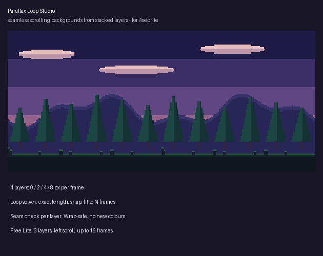

# Parallax Loop Studio Lite for Aseprite (free)

Stack background layers (far at the bottom), set a speed per layer, press Generate: a seamless looping scroll, tagged `scroll`.
Pixel-exact wrap-around, no new colours, one Ctrl+Z undoes it.

## Install
Double-click `parallax-loop-studio-lite.aseprite-extension` (Aseprite 1.3+).

## Use
Select the frame with your layers, then right-click the cel > Properties > **Parallax Loop Studio (Lite)...** (or Edit > FX).

**Lite limits:** the first 3 visible layers, scrolling left, whole-pixel speeds, loops up to 16 frames, one preset
(Forest 4-layer). The dialog shows the loop length live.

The full version adds any number of layers, left/right/up/down per layer, fractional speeds, snap speeds, fit-to-length,
per-layer repeat length in the solver, more presets and a seam report: https://mst-9.itch.io/parallax-loop-studio

**Disclosure:** the code was written with an AI coding assistant; no image AI is involved.

## Licence
MIT (this Lite version). The full version is a separate paid product.
